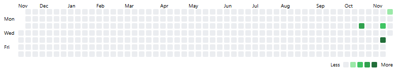

# react-contribution-graph



A lightweight, dependency-free React component that renders a GitHub-style contribution graph.

- Last 12 months, ending today
- Month and weekday labels
- Hover tooltip ("3 contributions on Nov 10, 2026")
- "Less / More" legend
- Customizable colors, cell size, gap, radius and font
- Written in TypeScript, types included

## Installation

```bash
npm install @your-npm-username/react-contribution-graph
```

Requires `react` and `react-dom` 18 or newer.

## Usage

```tsx
import { ContributionGraph, type Activity } from "@your-npm-username/react-contribution-graph";

const data: Activity[] = [
  { date: "2026-11-10", count: 3 },
  { date: "2026-11-12", count: 8 },
  { date: "2026-11-15", count: 1 },
];

export function App() {
  return <ContributionGraph data={data} />;
}
```

### Data format

Each item in `data` is one day:

| Field   | Type     | Description                           |
| ------- | -------- | ------------------------------------- |
| `date`  | `string` | Date in `YYYY-MM-DD` format           |
| `count` | `number` | Number of contributions on that day   |

Days that are not in `data` are shown as empty (count `0`).

Cell colors are relative: the day with the highest count gets the darkest color, and the other days are split into four levels based on their share of that maximum.

> **Tip:** Define `data` outside your component, or wrap it in `useMemo`. Passing a new array on every render makes the graph recalculate all days each time.

## Props

| Prop          | Type          | Default                                                       | Description                                                  |
| ------------- | ------------- | ------------------------------------------------------------- | ------------------------------------------------------------ |
| `data`        | `Activity[]`  | **required**                                                  | Contribution data (see [Data format](#data-format))          |
| `colors`      | `string[]`    | `["#ebedf0", "#9be9a8", "#40c463", "#30a14e", "#216e39"]`     | Five colors, from "no contributions" to "most contributions" |
| `showMonth`   | `boolean`     | `true`                                                        | Show month labels above the graph                            |
| `blockSize`   | `number`      | `11`                                                          | Width and height of each cell, in px                         |
| `blockGap`    | `number`      | `3`                                                           | Space between cells, in px                                   |
| `blockRadius` | `number`      | `2`                                                           | Border radius of each cell, in px                            |
| `fontSize`    | `number`      | `10`                                                          | Font size of labels, in px                                   |
| `fontFamily`  | `string`      | System font stack                                             | Font family of labels                                        |

### Custom colors

`colors` must contain exactly five colors:

```tsx
<ContributionGraph
  data={data}
  colors={["#161b22", "#0e4429", "#006d32", "#26a641", "#39d353"]}
/>
```

## TypeScript

The following types are exported:

```ts
import type { Activity, ContributionGraphProps } from "@your-npm-username/react-contribution-graph";
```

## Next.js

The component uses React state, so in the Next.js App Router it must be rendered inside a Client Component:

```tsx
"use client";

import { ContributionGraph } from "@your-npm-username/react-contribution-graph";
```

## License

[MIT](./LICENSE)
